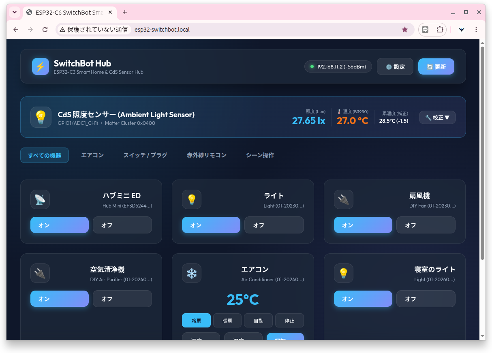

[English README is available here](./README.md)

---

# ESP32-C3 SwitchBot Smart Home Hub + 屋外センサー (ESP-NOW 二台構成)

ESP32-C3 2台を使ったスマートホームハブシステムです。**親機（屋内・USB給電）** が Matter Over Wi-Fi・SwitchBot API・Webサーバーを担い、**子機（ベランダ・電池駆動）** が ESP-NOW で照度・温度・電池電圧を送信します。親機はさらに GPIO3 のサーミスタで**屋内温度**をリアルタイム計測します。

---


> **📐 アーキテクチャ仕様書**: [`SPEC_SENSOR_SEPARATION_ESPNOW.md`](./SPEC_SENSOR_SEPARATION_ESPNOW.md) を参照してください。

---

## 🏗 システム構成

```
[ 子機 (ベランダ・電池) ]                [ 親機 (屋内・USB給電) ]
  ESP32-C3                                 ESP32-C3
  ├─ GPIO1: CdS (屋外照度)   ─ESP-NOW──▶  ├─ ESP-NOW 受信
  ├─ GPIO3: サーミスタ (屋外温度)           ├─ GPIO3: サーミスタ (屋内温度)
  ├─ GPIO0: 電池電圧 ADC                   ├─ Matter 3エンドポイント
  └─ Deep Sleep 5分周期                    ├─ Web サーバー / SwitchBot API
                                           └─ Wi-Fi / mDNS
```

| 役割 | デバイス | MAC アドレス |
|:---|:---|:---|
| **親機** (indoor hub) | ESP32-C3 | `90:DA:72:8B:23:FC` |
| **子機** (outdoor sensor) | ESP32-C3 | `E8:3D:C1:9C:36:18` |

---

## 🌟 特長 (Features)

- **ESP-NOW 無線センサーリンク**: 子機がDeep Sleep 5分周期で起動→計測→ESP-NOW送信→再スリープ。Wi-Fi不要で低消費電力。
- **Matter 3エンドポイント対応**:
  - `Endpoint 1`: 屋外照度 (子機から ESP-NOW 受信)
  - `Endpoint 2`: 屋内温度 (親機 GPIO3 サーミスタ)
  - `Endpoint 3`: 屋外温度 (子機から ESP-NOW 受信)
- **B3950 10kΩ サーミスタ温度計測 (親機・子機ともに)**:
  - `GPIO3` (ADC1_CH3) + 10kΩプルダウン抵抗でB定数(3950K)演算によるリアルタイム温度計測（℃）。
  - Web UI から温度オフセット校正値を NVS に永続保存可能。
- **CdS 照度計測 (子機)**:
  - `GPIO1` (ADC1_CH1) + 約9.1kΩプルダウンで CdS セルを高精度サンプリング。
  - Lux・Matter 規格 `MeasuredValue`（`10000 * log10(lux) + 1`）に自動換算。
- **電池電圧モニタ (子機)**: `GPIO0` (ADC1_CH0) で電源電圧を計測し ESP-NOW パケットで送信。
- **SoftAP フォールバック & NVS 永続化**: Wi-Fi未設定時は自動で AP モード (`ESP32-SwitchBot-Setup`, `192.168.4.1`) で起動。設定完了後は自動 Station モードへ移行。
- **SwitchBot Open API v1.1 HMAC-SHA256 認証**: `mbedtls` による暗号署名 (token / secret / ミリ秒 timestamp / nonce)。
- **NTP 時刻同期**: `esp_netif_sntp` による時刻取得で API リクエストに正確な署名を付与。
- **レスポンシブ Glassmorphism UI**: 照度・温度のリアルタイム表示と SwitchBot 家電操作カードを一体化。
- **mDNS (Bonjour) 対応**: `http://esp32-switchbot.local/` でアクセス可能。Matter の mDNS と共存する delegate hostname 方式を採用。
- **ファクトリーリセット**: `GPIO9` を 3 秒以上長押しで Matter & NVS をリセット。
- **Web UI 2点照度校正**: 校正値を NVS に永続保存。再起動後も自動適用。

---

## 🔌 ピン配置 (Pin Mapping)

### 親機（屋内 Hub）

| ESP32-C3 ピン | 接続先 | 役割 |
|:---|:---|:---|
| **3.3V** | サーミスタの片足 | 電源供給 |
| **GPIO3 (ADC1_CH3)** | B3950サーミスタとプルダウン抵抗(10kΩ)の接続点 | 屋内 ADC 温度計測入力 |
| **GND** | プルダウン抵抗の片足 | グランド |
| **GPIO9** | タクトスイッチ（GNDへ短絡） | 3秒長押しでファクトリーリセット |

> 親機の GPIO1 (CdS) は廃止。屋外照度は子機から ESP-NOW 受信。

### 子機（屋外センサー）

| ESP32-C3 ピン | 接続先 | 役割 |
|:---|:---|:---|
| **3.3V** | CdSセル・サーミスタの片足 | 電源供給 |
| **GPIO0 (ADC1_CH0)** | 電池電圧分圧回路の出力点 | 電池電圧 ADC 計測入力 |
| **GPIO1 (ADC1_CH1)** | CdSセルとプルダウン抵抗(約9.1kΩ)の接続点 | 屋外照度 ADC 計測入力 |
| **GPIO3 (ADC1_CH3)** | B3950サーミスタとプルダウン抵抗(10kΩ)の接続点 | 屋外温度 ADC 計測入力 |
| **GND** | プルダウン抵抗各片足 | グランド |

#### 電源（子機）
| 方法 | 接続 | 備考 |
|:---|:---|:---|
| USB 5V | USBコネクタ経由（内蔵LDOで3.3V変換） | 単1×4本 (約6V) またはUSB充電器 |
| 直結 3.3V | 3.3Vピン直接 | 単3×2本 (3V) ※LDO不使用 |

> 冬の屋外 (0℃以下) を考慮して**単1型アルカリ電池×4本**（約6V / USB経由）を推奨。

---

## 📡 ESP-NOW 通信プロトコル

子機は起動後に親機の MAC アドレス（`90:DA:72:8B:23:FC`）へユニキャスト送信します。

### パケット構造 (`main/esp_now_packet.h`)

```c
typedef struct {
    float lux;              // 照度 [Lux]
    float temp_celsius;     // 温度 [℃]
    float battery_voltage;  // 電池電圧 [V]
} esp_now_sensor_packet_t;
```

### チャンネルキャッシュ

子機は親機の Wi-Fi チャンネルを RTC メモリにキャッシュ（`RTC_DATA_ATTR`）し、起動ごとのスキャンをスキップして高速送信・低消費電力を実現します。

---

## 🏠 Matter 対応 (3エンドポイント)

| Endpoint | デバイスタイプ | データソース | Cluster |
|:---|:---|:---|:---|
| `1` | Light Sensor (`0x0106`) | 子機 (ESP-NOW) 屋外照度 | Illuminance Measurement `0x0400` |
| `2` | Temperature Sensor (`0x0302`) | 親機 GPIO3 屋内温度 | Temperature Measurement `0x0402` |
| `3` | Temperature Sensor (`0x0302`) | 子機 (ESP-NOW) 屋外温度 | Temperature Measurement `0x0402` |

### Matter コミッショニング情報

| 項目 | 値 |
|:---|:---|
| QR コード画像 | `matter_qr.png` |
| Payload | `MT:Y.K90AFN00KA0648G00` |
| 手入力コード | `34970112332` |

> Google Home / Apple Home の「デバイス追加」→「Matterデバイス」から上記コードでペアリング。

---

## 🛠 ビルドおよび書き込み方法 (Build & Flash)

### 環境変数のロード（共通）

```bash
source /home/kusa/esp/esp-idf/export.sh
source /home/kusa/esp/esp-matter/export.sh
```

### 親機 (indoor hub)

```bash
cd /home/kusa/ドキュメント/eSp32/SwitchBot+sensor
idf.py set-target esp32c3
idf.py build
idf.py -p /dev/ttyACM0 flash monitor
```

### 子機 (outdoor sensor)

```bash
cd /home/kusa/ドキュメント/eSp32/SwitchBot+sensor/outdoor_sensor
idf.py set-target esp32c3
idf.py build
idf.py -p /dev/ttyACM0 flash monitor
```

> ⚠️ 子機は Deep Sleep で即座にUSB切断されます。フラッシュ直後にモニタを開いて起動ログを確認してください。

#### テストモード（USB常時接続）

`outdoor_sensor/main/main.c` の以下の行を `1` に変更してビルド・フラッシュ:

```c
#define TEST_CONTINUOUS_MODE 1  // 0 = Deep Sleep (本番), 1 = 連続動作 (テスト)
```

---

## 🌐 ネットワークアクセス (Network Access)

| 方法 | URL | 備考 |
|:---|:---|:---|
| **mDNS (推奨)** | `http://esp32-switchbot.local/` | iOS / macOS / Windows 10以降 / Linux (Avahi) で対応 |
| **IPアドレス直接** | `http://<IPアドレス>/` | シリアルモニタで確認可能 |
| **SoftAP モード** | `http://192.168.4.1/` | 初期設定時・Wi-Fi未接続時 |

> **Linux で mDNS を使う場合**: `sudo apt install avahi-daemon libnss-mdns`

---

## 📡 REST API 仕様 (Local Endpoints)

| エンドポイント | メソッド | 説明 |
|---|---|---|
| `/` | `GET` | WebダッシュボードUIの配信 |
| `/api/status` | `GET` | IPアドレス、WiFi電波強度(RSSI)、メモリ、NTP同期状態 |
| `/api/sensor` | `GET` | センサー情報取得（屋内・屋外の照度・温度・電池電圧等） |
| `/api/config` | `POST` | Wi-FiおよびSwitchBot認証情報のNVS保存 |
| `/api/devices` | `GET` | SwitchBot Cloudから全デバイス・IRリモコン一覧を取得 |
| `/api/device/command` | `POST` | デバイスへの操作コマンド送信 (`{"deviceId":"...","command":"turnOn"}`) |
| `/api/scenes` | `GET` | 登録済みシーン一覧の取得 |
| `/api/scene/execute` | `POST` | シーンの実行 (`{"sceneId":"..."}`) |
| `/api/sensor/calibrate` | `GET` | 現在の CdS 校正パラメータ取得 |
| `/api/sensor/calibrate` | `POST` | 校正点の記録、温度オフセット保存、またはNVS保存 |

### `/api/sensor` レスポンス例

```json
{
  "raw_adc": 0,
  "lux": 0.0,
  "temp_celsius": 24.1,
  "temp_offset": 0.0,
  "outdoor_lux": 0.3,
  "outdoor_temp_celsius": 23.2,
  "outdoor_battery_voltage": 3.72,
  "outdoor_last_seen_sec": 12,
  "outdoor_mac": "E8:3D:C1:9C:36:18",
  "outdoor_valid": true
}
```

---

## ⚙️ 初期セットアップ

### 1. Wi-Fi & SwitchBot API 設定

1. ESP32-C3 (親機) に電源投入。未設定の場合は `ESP32-SwitchBot-Setup` に接続して `http://192.168.4.1/` を開く。
2. 右上の **⚙️ 設定** をクリック。
3. **Wi-Fi SSID / パスワード** を入力。
4. SwitchBot アプリ → プロフィール → 開発者向けオプション → Token と Secret を取得してペースト。
5. **「保存して接続」** をクリック。再起動後に自宅Wi-Fiへ接続されます。

### 2. Matter コミッショニング (Google Home)

1. 親機が自宅Wi-Fiに接続済みであることを確認。
2. Google Home アプリ → **デバイスの追加** → **Matter対応デバイス**。
3. `matter_qr.png` のQRコード、または手入力コード `34970112332` でペアリング。

### 3. センサー校正 (Web Dashboard)

1. `http://esp32-switchbot.local/` → **🔧 校正▼** をクリック。
2. **Point 1 (明るい側)**: 照度計の実測値を入力して「現在値で記録」。
3. **Point 2 (暗い側)**: 暗い環境に変えて「現在値で記録」。
4. 温度のズレがある場合はオフセット値 (例: `-0.5`) を入力して「温度オフセット保存」。
5. **「💾 NVSに保存」** で確定。

---

## 🔧 CdS センサー校正モデル

```
lux = A × (R_ref / R_cds)^n
```

| パラメータ | 説明 |
|:---|:---|
| `A` | 基準照度（Point 1 の Lux 値） |
| `R_ref` | Point 1 の CdS 抵抗値 (Ω) |
| `n` | べき乗指数（2点の比から自動算出） |

### NVS キー (namespace: `sb_storage`)

| キー | 型 | 説明 |
|:---|:---|:---|
| `cds_raw1` | i32 | Point 1 の ADC 生値 |
| `cds_lux1` | blob (float) | Point 1 の実測照度 (Lux) |
| `cds_raw2` | i32 | Point 2 の ADC 生値 |
| `cds_lux2` | blob (float) | Point 2 の実測照度 (Lux) |
| `temp_offset` | blob (float) | 温度オフセット値 (℃) |

---

## 📁 プロジェクト構成

```
SwitchBot+sensor/
├── main/
│   ├── main.cpp                # 親機ファームウェア (Matter 3EP, ESP-NOW受信, 屋内温度タスク)
│   ├── web_server.c            # Webサーバー・REST API (outdoor_* フィールド追加済み)
│   ├── esp_now_packet.h        # 共有パケット構造体定義
│   └── CMakeLists.txt
├── outdoor_sensor/             # 子機サブプロジェクト
│   ├── main/
│   │   └── main.c              # 子機ファームウェア (Deep Sleep, ESP-NOW送信)
│   └── CMakeLists.txt
├── SPEC_SENSOR_SEPARATION_ESPNOW.md  # アーキテクチャ仕様書
├── matter_qr.png               # Matter コミッショニング QR コード
├── web_page.png                # Web UI スクリーンショット
├── README.JP.md                # 本ファイル (日本語)
└── README.md                   # English README
```

---

## 📜 License

This project is open source and available under the [MIT License](LICENSE).
