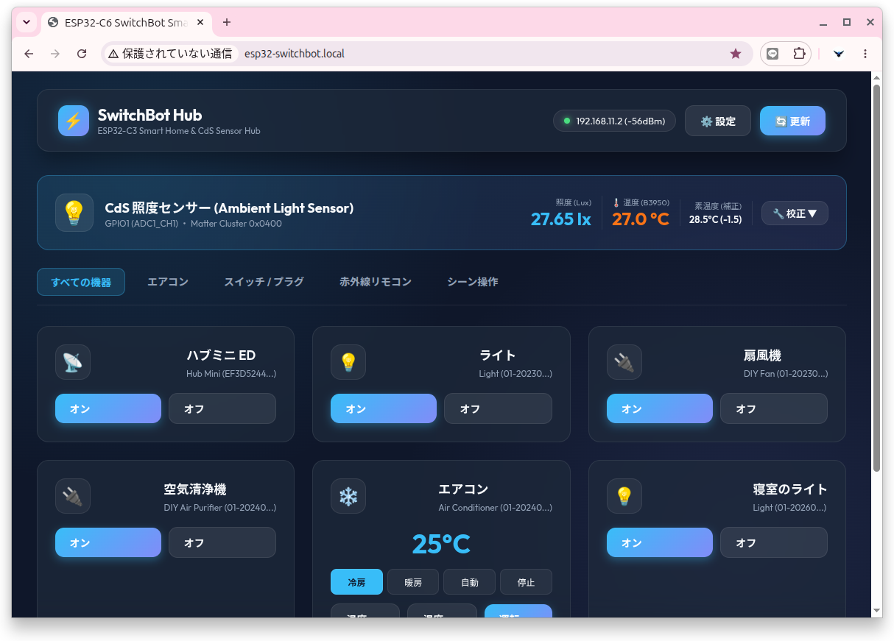

[日本語版のREADMEはこちら (Japanese README is available here)](./README.JP.md)

---

# ESP32-C3 SwitchBot Smart Home Hub + Outdoor Sensor (Dual-Device ESP-NOW Architecture)

A smart home hub system built with two **ESP32-C3** boards. The **parent hub (indoor, USB-powered)** handles Matter Over Wi-Fi, SwitchBot API, and a web server. The **child sensor (balcony, battery-powered)** wakes from Deep Sleep every 5 minutes, measures illuminance, temperature, and battery voltage, and transmits via **ESP-NOW**. The parent also monitors **indoor temperature** via its own GPIO3 thermistor.

---


> **📐 Architecture Specification**: See [`SPEC_SENSOR_SEPARATION_ESPNOW.md`](./SPEC_SENSOR_SEPARATION_ESPNOW.md) for the full system design.

---

## 🏗 System Architecture

```
[ Child Device (Balcony, Battery) ]       [ Parent Hub (Indoor, USB) ]
  ESP32-C3                                   ESP32-C3
  ├─ GPIO1: CdS (outdoor lux)   ─ESP-NOW──▶  ├─ ESP-NOW Receiver
  ├─ GPIO3: Thermistor (outdoor temp)         ├─ GPIO3: Thermistor (indoor temp)
  ├─ GPIO0: Battery voltage ADC               ├─ Matter 3 Endpoints
  └─ Deep Sleep 5-min cycle                   ├─ Web Server / SwitchBot API
                                              └─ Wi-Fi / mDNS
```

| Role | Device | MAC Address |
|:---|:---|:---|
| **Parent** (indoor hub) | ESP32-C3 | `90:DA:72:8B:23:FC` |
| **Child** (outdoor sensor) | ESP32-C3 | `E8:3D:C1:9C:36:18` |

---

## 🌟 Key Features

- **ESP-NOW Wireless Sensor Link**: Child wakes from Deep Sleep every 5 minutes → reads sensors → sends ESP-NOW unicast to parent → sleeps. No Wi-Fi stack required on child.
- **Matter 3 Endpoints**:
  - `Endpoint 1`: Outdoor illuminance (received via ESP-NOW from child)
  - `Endpoint 2`: Indoor temperature (parent GPIO3 thermistor)
  - `Endpoint 3`: Outdoor temperature (received via ESP-NOW from child)
- **B3950 10kΩ Thermistor Temperature (parent & child)**:
  - `GPIO3` (ADC1_CH3) + 10kΩ pull-down, B-parameter (3950K) equation for real-time °C measurement.
  - Configurable ±°C offset from Web UI, persisted in NVS.
- **CdS Illuminance Measurement (child)**:
  - `GPIO1` (ADC1_CH1) + ~9.1kΩ pull-down (100kΩ ‖ 10kΩ) with 10-sample averaging.
  - Converted to Lux and Matter `MeasuredValue` (`10000 * log10(lux) + 1`).
- **Battery Voltage Monitor (child)**: `GPIO0` (ADC1_CH0) measures supply voltage, transmitted in every ESP-NOW packet.
- **SoftAP Fallback & NVS Storage**: Automatically enters AP mode (`ESP32-SwitchBot-Setup`, `192.168.4.1`) when Wi-Fi is not configured or connection fails.
- **SwitchBot Open API v1.1 HMAC-SHA256 Auth**: Built-in `mbedtls` cryptographic signing (token / secret / ms timestamp / random nonce).
- **NTP Time Synchronization**: `esp_netif_sntp` for accurate API request signing.
- **Responsive Glassmorphism Web UI**: Live sensor display banners + SwitchBot appliance control cards.
- **mDNS (Bonjour)**: Access via `http://esp32-switchbot.local/`. Uses delegate hostname scheme compatible with Matter mDNS.
- **Factory Reset**: Hold `GPIO9` for >3s to reset Matter commissioning & NVS config.
- **Web UI 2-Point Lux Calibration**: Calibration coefficients persisted in NVS, auto-applied on reboot.

---

## 🔌 Pin Mapping

### Parent Hub (Indoor)

| ESP32-C3 Pin | Connected To | Role |
|:---|:---|:---|
| **3.3V** | Thermistor leg | Power |
| **GPIO3 (ADC1_CH3)** | Node between B3950 thermistor and 10kΩ pull-down | ADC indoor temperature input |
| **GND** | Pull-down resistor leg | Ground |
| **GPIO9** | Tactile button (to GND) | Factory Reset (hold >3s) |

> GPIO1 (CdS) is no longer used on the parent. Outdoor lux now comes from the child via ESP-NOW.

### Child Sensor (Outdoor)

| ESP32-C3 Pin | Connected To | Role |
|:---|:---|:---|
| **3.3V** | CdS cell & Thermistor legs | Power |
| **GPIO0 (ADC1_CH0)** | Battery voltage divider output | Battery voltage ADC |
| **GPIO1 (ADC1_CH1)** | Node between CdS cell and ~9.1kΩ pull-down | ADC outdoor illuminance input |
| **GPIO3 (ADC1_CH3)** | Node between B3950 thermistor and 10kΩ pull-down | ADC outdoor temperature input |
| **GND** | Pull-down resistor legs | Ground |

#### Power Options (Child)

| Method | Connection | Notes |
|:---|:---|:---|
| USB 5V | Via USB connector (internal LDO → 3.3V) | **4× Size-D (単1) alkaline** (~6V) recommended |
| Direct 3.3V | 3.3V pin | 2× AA (3V) — bypasses LDO |

> For winter outdoor use (down to 0°C), **4× Size-D alkaline cells** via USB provide safe headroom.

---

## 📡 ESP-NOW Communication Protocol

The child transmits a unicast packet to the parent's MAC (`90:DA:72:8B:23:FC`) after each wake cycle.

### Packet Structure (`main/esp_now_packet.h`)

```c
typedef struct {
    float lux;              // Illuminance [Lux]
    float temp_celsius;     // Temperature [°C]
    float battery_voltage;  // Battery voltage [V]
} esp_now_sensor_packet_t;
```

### Channel Caching

The child caches the parent's Wi-Fi channel in RTC memory (`RTC_DATA_ATTR`) across Deep Sleep cycles, skipping a full Wi-Fi scan on each wake and minimizing on-time.

---

## 🏠 Matter Integration (3 Endpoints)

| Endpoint | Device Type | Data Source | Cluster |
|:---|:---|:---|:---|
| `1` | Light Sensor (`0x0106`) | Child (ESP-NOW) outdoor lux | Illuminance Measurement `0x0400` |
| `2` | Temperature Sensor (`0x0302`) | Parent GPIO3 indoor temp | Temperature Measurement `0x0402` |
| `3` | Temperature Sensor (`0x0302`) | Child (ESP-NOW) outdoor temp | Temperature Measurement `0x0402` |

### Matter Commissioning

| Item | Value |
|:---|:---|
| QR Code image | `matter_qr.png` |
| QR Payload | `MT:Y.K90AFN00KA0648G00` |
| Manual pairing code | `34970112332` |

> In Google Home / Apple Home: **Add Device** → **Matter-enabled device** → scan QR or enter code above.

---

## 🛠 Build & Flash

### Load Environment (required for both devices)

```bash
source /home/kusa/esp/esp-idf/export.sh
source /home/kusa/esp/esp-matter/export.sh
```

### Parent Hub (indoor)

```bash
cd /path/to/SwitchBot+sensor
idf.py set-target esp32c3
idf.py build
idf.py -p /dev/ttyACM0 flash monitor
```

### Child Sensor (outdoor)

```bash
cd /path/to/SwitchBot+sensor/outdoor_sensor
idf.py set-target esp32c3
idf.py build
idf.py -p /dev/ttyACM0 flash monitor
```

> ⚠️ The child enters Deep Sleep immediately after boot, disconnecting USB. Open the serial monitor right after flashing to catch startup logs.

#### Test Mode (continuous operation over USB)

In `outdoor_sensor/main/main.c`, change:

```c
#define TEST_CONTINUOUS_MODE 1  // 0 = Deep Sleep (production), 1 = continuous (test)
```

---

## 🌐 Network Access

| Method | URL | Description |
|:---|:---|:---|
| **mDNS (Recommended)** | `http://esp32-switchbot.local/` | iOS, macOS, Windows 10+, Linux (Avahi) |
| **Direct IP** | `http://<ESP32_IP>/` | Check serial monitor for assigned IP |
| **SoftAP Mode** | `http://192.168.4.1/` | Initial setup / fallback |

> **Linux**: `sudo apt install avahi-daemon libnss-mdns`

---

## 📡 REST API Specifications (Local Endpoints)

| Endpoint | Method | Description |
|---|---|---|
| `/` | `GET` | Serves the single-page Web Dashboard |
| `/api/status` | `GET` | System status (IP, RSSI, free heap, NTP sync) |
| `/api/sensor` | `GET` | Live sensor data — indoor & outdoor lux/temp/battery |
| `/api/config` | `POST` | Save Wi-Fi & SwitchBot API credentials to NVS |
| `/api/devices` | `GET` | Fetch all SwitchBot devices & IR remotes |
| `/api/device/command` | `POST` | Send control command (`{"deviceId":"...","command":"turnOn"}`) |
| `/api/scenes` | `GET` | Fetch registered SwitchBot scenes |
| `/api/scene/execute` | `POST` | Execute a scene (`{"sceneId":"..."}`) |
| `/api/sensor/calibrate` | `GET` | Get current CdS calibration parameters |
| `/api/sensor/calibrate` | `POST` | Record calibration points, save temp offset, or persist to NVS |

### `/api/sensor` Response Example

```json
{
  "raw_adc": 0,
  "lux": 0.0,
  "temp_celsius": 24.1,
  "temp_offset": 0.0,
  "outdoor_lux": 0.3,
  "outdoor_temp_celsius": 23.2,
  "outdoor_battery_voltage": 3.72,
  "outdoor_last_seen_sec": 12,
  "outdoor_mac": "E8:3D:C1:9C:36:18",
  "outdoor_valid": true
}
```

---

## ⚙️ Initial Setup Guide

### 1. Wi-Fi & SwitchBot API Configuration

1. Power on the parent ESP32-C3. If unconfigured, connect to `ESP32-SwitchBot-Setup` Wi-Fi and open `http://192.168.4.1/`.
2. Click **⚙️ Settings** (top right).
3. Enter your **Wi-Fi SSID & Password**.
4. In the SwitchBot app → Profile → Developer Options → Copy Token & Secret Key.
5. Paste into the dialog and click **Save & Connect**. The device will reboot and join your home Wi-Fi.

### 2. Matter Commissioning (Google Home)

1. Confirm the parent is connected to your home Wi-Fi.
2. Google Home app → **Add Device** → **Matter-enabled device**.
3. Scan `matter_qr.png` or enter manual code `34970112332`.

### 3. Sensor Calibration (Web Dashboard)

1. Open `http://esp32-switchbot.local/` → click **🔧 Calibration ▼**.
2. **Point 1 (Bright)**: Enter measured lux from a reference meter, click **Record Current**.
3. **Point 2 (Dark)**: Darken the environment, click **Record Current**.
4. If temperature differs from a reference thermometer, enter the offset (e.g. `-0.5`) and click **Save Temp Offset**.
5. Click **💾 Save to NVS** to persist all calibration data.

---

## 🔧 CdS Calibration Model

```
lux = A × (R_ref / R_cds)^n
```

| Parameter | Description |
|:---|:---|
| `A` | Reference illuminance (Point 1 lux value) |
| `R_ref` | CdS resistance at Point 1 (Ω) |
| `n` | Power exponent (auto-computed from two calibration points) |

### NVS Keys (namespace: `sb_storage`)

| Key | Type | Description |
|:---|:---|:---|
| `cds_raw1` | i32 | ADC raw value at Point 1 |
| `cds_lux1` | blob (float) | Measured lux at Point 1 |
| `cds_raw2` | i32 | ADC raw value at Point 2 |
| `cds_lux2` | blob (float) | Measured lux at Point 2 |
| `temp_offset` | blob (float) | Temperature offset (°C) |

---

## 📁 Project Structure

```
SwitchBot+sensor/
├── main/
│   ├── main.cpp                # Parent firmware (Matter 3 EP, ESP-NOW receiver, indoor temp task)
│   ├── web_server.c            # Web server & REST API (includes outdoor_* fields)
│   ├── esp_now_packet.h        # Shared ESP-NOW packet struct definition
│   └── CMakeLists.txt
├── outdoor_sensor/             # Child device subproject
│   ├── main/
│   │   └── main.c              # Child firmware (Deep Sleep, ESP-NOW sender)
│   └── CMakeLists.txt
├── SPEC_SENSOR_SEPARATION_ESPNOW.md  # Full architecture specification
├── matter_qr.png               # Matter commissioning QR code
├── web_page.png                # Web UI screenshot
├── README.JP.md                # Japanese README
└── README.md                   # This file
```

---

## 📜 License

This project is open source and available under the [MIT License](LICENSE).
